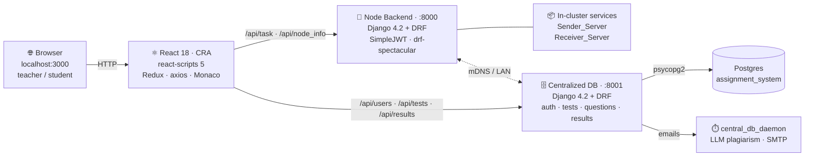

# Smart Education — main tech-stack flow

## Components

| Layer | Tech | What it does |
|---|---|---|
| Frontend | React 18 (CRA) + react-scripts 5 | Teacher & student UI, Redux state, Monaco editor, recharts |
| Node backend | Django 4.2 + DRF + SimpleJWT | Owns in-cluster Sender/Receiver services, dispatches code-execution tasks, exposes node info |
| Centralized DB | Django 4.2 + DRF | Auth, tests, questions, results, schedule — the shared store front-end |
| Storage | Postgres (psycopg2) | Persistent rows; SQLite used in dev (`db.sqlite3`) |
| Discovery | zeroconf / mDNS (ifaddr) | Node advertises itself on the LAN; in single-host dev, ports 8000/8001 are pinned |
| Side services | central_db_daemon | Polls for expired lockdown schedules → triggers LLM plagiarism + email dispatch |
| Packaging | venv + `launcher.py` | Tkinter splash that starts Django + npm and opens the browser |

## How a request flows

1. Browser opens `localhost:3000` (CRA dev server) or the built bundle.
2. React calls `discoverServers()` → `GET /api/node_info/` on the node backend (proxied via `setupProxy.js`).
3. React learns node URL (`:8000`) and central DB URL (`:8001`).
4. **Two parallel surfaces:**
   - Node calls → `/api/task`, `/api/task_status`, `/api/problems` (code execution + question fetch).
   - Central calls → `/api/users/login`, `/api/tests`, `/api/questions`, `/api/results`, `/api/schedule`.
5. Central DB persists to Postgres; the daemon watches for ended lockdowns and sends results via SMTP.

## Key files

- `Backend/System_Management/manage.py` — node Django entrypoint; spawns `system_monitor` and `start_dispatcher` threads on `RUN_MAIN`.
- `Backend/System_Management/api_management/urls.py` — `/api/node_info/`, `/api/task/`, etc.
- `Centralized_Database/manage.py` — central Django entrypoint; `central_db_daemon.py` is the standalone polling process.
- `Frontend/system_interface/src/config/serverDiscovery.js` — discovery + URL resolution.
- `Frontend/system_interface/src/setupProxy.js` — dev proxy from `:3000/api/*` → `:8000`.
- `launcher.py` — splash + bring-up; `stop_servers.py` — teardown by port.
